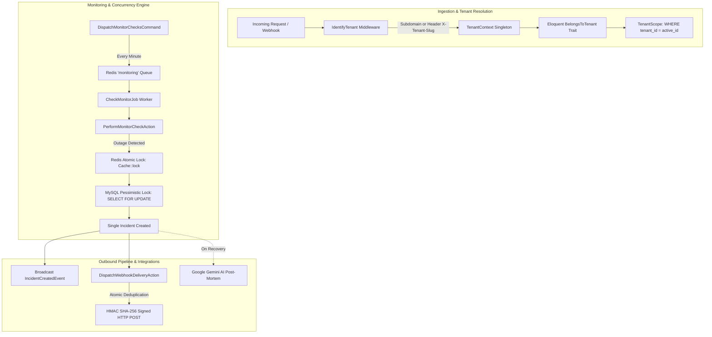

# PulseForge ⚡

> **Multi-Tenant Incident Management & Service Health Monitoring SaaS**  
> *A portfolio demonstration of modern mid-to-senior backend engineering in Laravel 13 & PHP 8.4.*

---

## 🚀 Key Highlights & Badges


-00D26A?style=for-the-badge)


---

## 📖 Executive Summary

**PulseForge** is an automated incident response and service health monitoring platform (similar to *Better Stack* and *Datadog + Statuspage*). It probes HTTP/HTTPS endpoints, tracks latency with millisecond precision, inspects SSL certificate validity, coordinates incident life cycles, and dispatches HMAC-signed webhooks to subscribers.

Beyond standard CRUD, PulseForge was architected from the ground up to solve complex distributed systems challenges:
1. **Multi-Tenancy Isolation:** Fail-closed single-database tenancy with automated Eloquent scoping and zero cross-tenant data leakage.
2. **Race Condition Defenses:** Three distinct enterprise concurrency patterns defending against subscription quota bypasses, worker stampedes, and duplicate webhook delivery.
3. **Automated Health Engine:** Asynchronous Redis queue workers probing endpoints with sub-millisecond timers and database-agnostic interval scheduling.
4. **Third-Party Sandboxes:** Google Gemini API for AI-powered Incident Post-Mortems/RCAs, Stripe Test Mode for subscription lifecycles, and Mailpit for transactional email.

---

## 🏛️ System Architecture



---

## 🛡️ Senior Concurrency & Race Condition Defenses

### 1. Subscription Quota Defense (Pessimistic DB Row Lock)
- **Problem:** Parallel concurrent API requests (e.g. 10 simultaneous requests from an automated script) could bypass plan monitor quotas because non-locking checks (`$count < $limit`) evaluate true before rows are committed.
- **Solution:** [`CreateMonitorAction`](./app/Actions/Monitors/CreateMonitorAction.php) runs in a DB transaction with `Tenant::where('id', $id)->lockForUpdate()`, evaluating quotas under the lock and throwing [`SubscriptionQuotaExceededException`](./app/Exceptions/SubscriptionQuotaExceededException.php).

### 2. Worker Stampede Defense (Redis Atomic Locks + DB Row Lock)
- **Problem:** When an external service goes down, multiple concurrent background health-check workers report failures nearly simultaneously. Without locking, each worker would evaluate "Threshold exceeded" and create duplicate incident records.
- **Solution:** [`ProcessMonitorFailureAction`](./app/Actions/Incidents/ProcessMonitorFailureAction.php) uses a distributed **Redis Atomic Lock** (`Cache::lock("incident:monitor:{$id}", 10)->block(5, ...)`) combined with a DB pessimistic check on unresolved incidents (`Incident::where('monitor_id', $id)->whereNull('resolved_at')->lockForUpdate()`). Only **one** incident is ever created per outage lifecycle.

### 3. Webhook Delivery Deduplication (Atomic SQL Transitions)
- **Problem:** Queue retries and multi-worker execution can cause workers to process the same delivery record simultaneously, firing duplicate HTTP notifications to subscribers.
- **Solution:** [`DispatchWebhookDeliveryAction`](./app/Actions/Webhooks/DispatchWebhookDeliveryAction.php) uses a direct conditional atomic SQL update:
  ```sql
  UPDATE webhook_deliveries
  SET status = 'in_flight', attempts = attempts + 1, last_attempt_at = NOW()
  WHERE id = ? AND status = 'pending';
  ```
  If `0` rows are affected, another worker has claimed it and the current worker bails out immediately, guaranteeing zero duplicate outbound webhooks.

---

## 🛠️ Code Conventions & Design Patterns

- **Single-Responsibility Actions:** Business logic lives exclusively in invokable Action classes (e.g., [`CreateMonitorAction`](./app/Actions/Monitors/CreateMonitorAction.php), [`PerformMonitorCheckAction`](./app/Actions/Monitors/PerformMonitorCheckAction.php), [`ProcessMonitorFailureAction`](./app/Actions/Incidents/ProcessMonitorFailureAction.php)).
- **Readonly DTOs:** Strongly-typed immutable data carriers ([`CreateMonitorDTO`](./app/DTOs/CreateMonitorDTO.php), [`MonitorCheckResultDTO`](./app/DTOs/MonitorCheckResultDTO.php)).
- **Backed PHP Enums:** Clean domain states ([`TenantPlan`](./app/Enums/TenantPlan.php), [`MonitorStatus`](./app/Enums/MonitorStatus.php), [`IncidentStatus`](./app/Enums/IncidentStatus.php), [`WebhookEvent`](./app/Enums/WebhookEvent.php)).
- **Fail-Closed Tenancy:** Models use [`BelongsToTenant`](./app/Traits/BelongsToTenant.php) with automatic `tenant_id` stamping and anti-hijacking exceptions.
- **Strict Typing:** `declare(strict_types=1);` enforced across the entire `App` namespace via Pest architecture assertions.

---

## 🐳 Docker Setup & Zero-Conflict Port Matrix

PulseForge runs 100% containerized on Windows 11 with custom non-colliding host ports:

| Service | Container Name | Host Port | Internal Port | Environment URL |
| :--- | :--- | :--- | :--- | :--- |
| **Web Server (Nginx)** | `pulseforge-web` | `8080` | `80` | [http://localhost:8080](http://localhost:8080) |
| **MySQL 8.0** | `pulseforge-mysql` | `33077` | `3306` | `127.0.0.1:33077` |
| **Redis (phpredis)** | `pulseforge-redis` | `6380` | `6379` | `127.0.0.1:6380` |
| **Mailpit Web UI** | `pulseforge-mailpit` | `8025` | `8025` | [http://localhost:8025](http://localhost:8025) |
| **Mailpit SMTP** | `pulseforge-mailpit` | `1025` | `1025` | `127.0.0.1:1025` |

### Quick Start (Clone & Run):
```bash
# 1. Clone the repository
git clone https://github.com/RehmanWaheed/PulseForge.git
cd PulseForge

# 2. Copy the environment configuration
cp .env.example .env

# 3. Start all containers in the background
docker compose up -d

# 4. Generate application key & run migrations with seed data
docker compose exec app php artisan key:generate
docker compose exec app php artisan migrate --seed

# 5. Run tests & static analysis
docker compose exec app ./vendor/bin/pest
docker compose exec app ./vendor/bin/phpstan analyse
```

### Running Health Checks & Queue Worker:
```powershell
# Dispatch due health checks
docker compose exec app php artisan monitors:dispatch-checks

# Run queue worker for monitoring, webhooks, and alerts
docker compose exec app php artisan queue:work --queue=monitoring,webhooks,default --stop-when-empty
```

---

## 🧪 Testing Suite (Pest PHP 3)

PulseForge features **52 automated tests with 151 assertions** verifying end-to-end reliability:

```bash
   PASS  Tests\Unit\ExampleTest
   PASS  Tests\Unit\TenantContextTest
   PASS  Tests\Unit\TenantPlanTest
   PASS  Tests\Unit\WebhookSignerTest
   PASS  Tests\Feature\ArchitectureTest (Strict types, invokable actions, readonly DTOs)
   PASS  Tests\Feature\ExampleTest
   PASS  Tests\Feature\GeminiPostMortemTest (AI Root Cause Analysis & Plan Gating)
   PASS  Tests\Feature\IncidentEmailAlertTest (Automated outage & recovery notifications)
   PASS  Tests\Feature\MonitorCheckEngineTest (HTTP probing, latency, timeouts)
   PASS  Tests\Feature\RealTimeAlertsTest (Laravel Reverb WebSocket broadcasting)
   PASS  Tests\Feature\StripeSubscriptionLifecycleTest (Subscription webhooks)
   PASS  Tests\Feature\SubscriptionQuotaLockTest (Pessimistic row locking)
   PASS  Tests\Feature\TenantScopingTest (Multi-tenancy isolation & anti-hijacking)
   PASS  Tests\Feature\WebhookDeduplicationTest (Atomic state transitions & HMAC)
   PASS  Tests\Feature\WorkerStampedeLockTest (Redis atomic locking)

Tests:    52 passed (151 assertions)
Duration: ~30s
```

---

## 📚 Step-by-Step Buildup Notes
Every milestone of this project is documented in the [`step-by-step-buildup-notes/`](./step-by-step-buildup-notes) directory:
- [Phase 1: Environment Baseline & Container Setup](./step-by-step-buildup-notes/phase-1-environment-and-baseline.md)
- [Phase 2: Multi-Tenancy Architecture (Foundation & Scoping)](./step-by-step-buildup-notes/phase-2-multi-tenancy-architecture.md)
- [Phase 3: Core Domain & Concurrency Defenses](./step-by-step-buildup-notes/phase-3-core-domain-and-race-conditions.md)
- [Phase 4: Health Check & Monitoring Engine](./step-by-step-buildup-notes/phase-4-health-check-engine.md)
- [Phase 5: Outbound Webhooks & Race Condition Defense #3](./step-by-step-buildup-notes/phase-5-outbound-webhooks.md)
- [Phase 6: Third-Party Sandboxes, AI Post-Mortems & Real-Time Alerting](./step-by-step-buildup-notes/phase-6-integrations-and-realtime.md)
- [Phase 7: Portfolio Polish & Architecture Documentation](./step-by-step-buildup-notes/phase-7-portfolio-polish.md)
